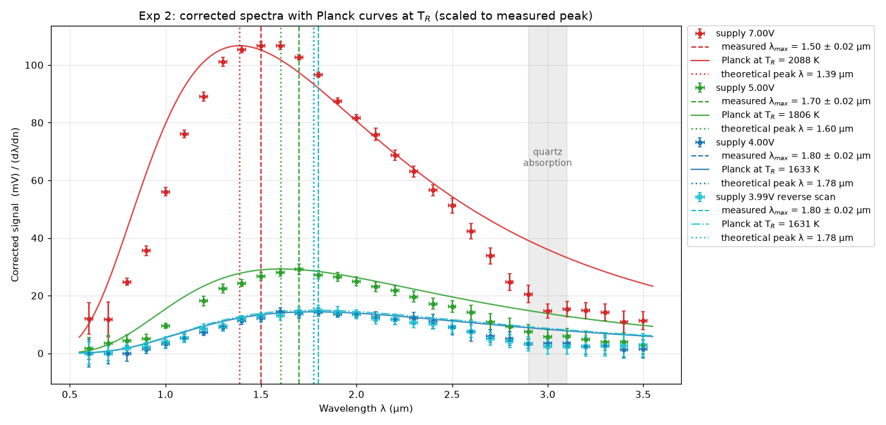

# Black-body radiation: tungsten filament spectra

Plots the corrected spectrum of a tungsten lamp filament, measured with a prism spectrometer and a thermopile, at three supply voltages plus a repeat (reverse) scan. Each spectrum is compared with Planck's law.

## Graphs

| File | What it shows |
|---|---|
| `graphs/exp2_spectra.png` | Data with Planck curves at **T_R**, the temperature from filament resistance (R = V/I → R/R₃₀₀ → calibration). Dashed lines mark the measured λ_max and dotted lines mark the theoretical peak. |
| `graphs/exp2_spectra_TWien.png` | The same data with Planck curves at **T_Wien** = 2897.8 µm K / λ_max. |



## Method

- **Corrected signal:** (full signal − background) / (dλ/dn), in mV. Uncertainties are added in quadrature.
- **Measured λ_max:** the wavelength of the highest data point. At 4.00 V the peak is flat, so the second-highest point (1.8 µm) is used, which matches the repeat scan. The uncertainty is σ_λ = 0.02 µm.
- **Planck curve:** B_λ = (2hc²/λ⁵) / (exp(hc/λk_BT) − 1), with λ in metres. Each curve is scaled so its peak height equals the measured peak; there is no least-squares fit.

## Run

```
pip install numpy matplotlib
python exp2_spectra_plot.py
```

All data is hard-coded in the script. The graphs are saved to `graphs/`.
